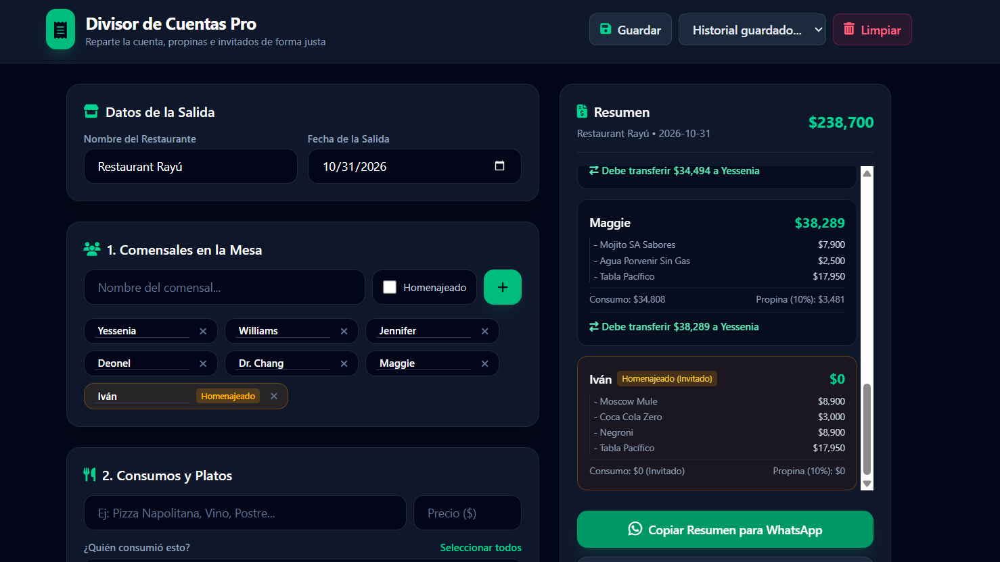
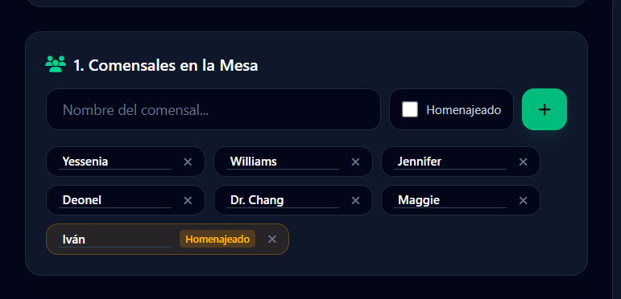
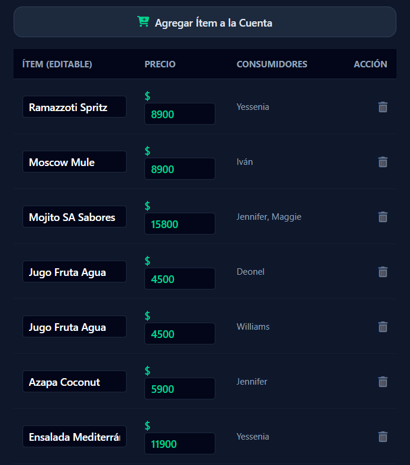
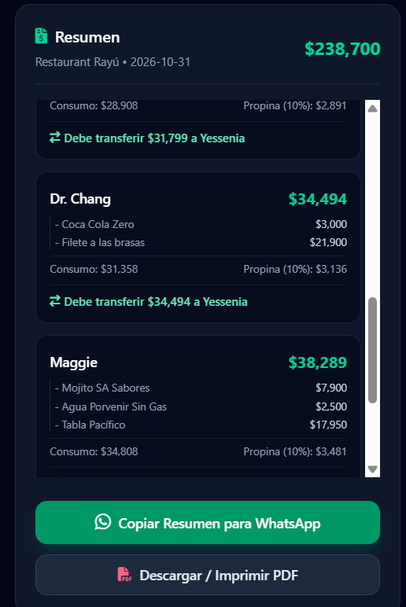

# 🧾 Divisor de Cuentas Pro

Una aplicación web moderna, interactiva y ligera diseñada para solucionar el clásico dolor de cabeza al salir a comer en grupo: dividir la cuenta del restaurante de forma justa, calcular propinas proporcionales, gestionar invitados/homenajeados y facilitar las transferencias bancarias.


---

## ✨ Características Principales

* **👥 Gestión de Comensales:** Agrega a todos los integrantes de la mesa con facilidad.
* **👑 Manejo de Homenajeados:** Marca a un cumpleañero o invitado de honor; su consumo se distribuye automáticamente de forma equitativa entre los demás comensales.
* **🍕 Consumos Individuales y Compartidos:** Asigna platos específicos a una persona o repártelos entre varios con un solo clic (botón "Seleccionar todos").
* **💰 Cálculo de Propina Proporcional:** Deslizador ajustable (0% a 25%) que calcula el porcentaje de propina de manera proporcional al consumo de cada integrante.
* **💳 Control de Pagador Global:** Selecciona quién pagó con tarjeta para que la app indique de forma clara cuánto debe transferir cada amigo.
* **💾 Persistencia (LocalStorage):** Guarda tus cuentas automáticamente en el navegador y recupera cuentas anteriores desde un historial rápido.
* **📱 Resumen para WhatsApp:** Genera un texto formateado y ordenado listo para copiar y pegar en el grupo de chat de los amigos.
* **📄 Exportación a PDF:** Interfaz limpia adaptada para impresión y generación de reportes en PDF sin perder calidad ni estilos.

---

## 📸 Capturas de Pantalla de la Aplicación

### 1. Vista Inicial de la Interfaz
*Panel principal con diseño en dos columnas, listo para comenzar a registrar comensales y platos.*


### 2. Gestión de Comensales y Homenajeados
*Listado de amigos agregados, destacando al homenajeado/invitado de la noche.*


### 3. Registro de Consumos e Ítems Compartidos
*Tabla de platos agregados con asignación de consumidores y opciones de selección múltiple.*


### 4. Resumen Final y Panel de Transferencias
*Cálculo en tiempo real por persona, desglosando consumo, propina y a quién se debe transferir.*


---

## 🚀 Uso Rápido (Demo Local)

1. Clona este repositorio o descarga el archivo `index.html`.
2. Abre el archivo `index.html` en cualquier navegador web moderno (Chrome, Edge, Safari, Firefox).
3. ¡Listo! Comienza a agregar comensales y platos.

---

## 🛠️ Tecnologías Utilizadas

* **HTML5 & JavaScript (Vanilla):** Lógica del cliente y manipulación del DOM sin frameworks pesados.
* **Tailwind CSS v4:** Estilos modernos mediante CDN para un diseño responsivo y elegante en modo oscuro.
* **FontAwesome:** Iconografía intuitiva.
* **LocalStorage API:** Almacenamiento local de datos en el navegador.

---

## 📦 Commit Final para GitHub

Para guardar los cambios de tu `README.md` y las imágenes en tu repositorio, ejecuta los siguientes comandos en tu terminal:

```bash
git add README.md docs/images/
git commit -m "docs: actualizar README con capturas de pantalla tituladas y organizadas"
git push origin main